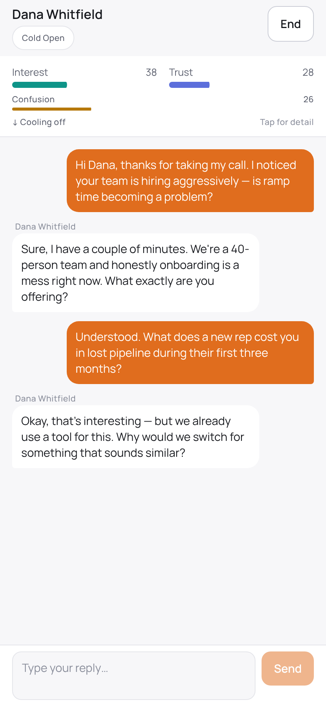
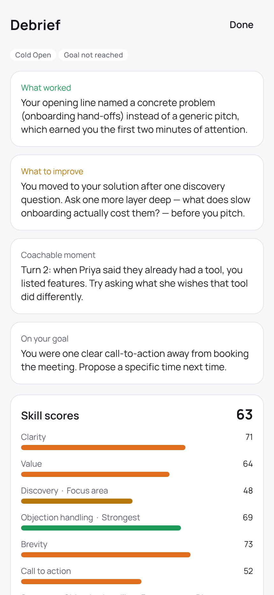
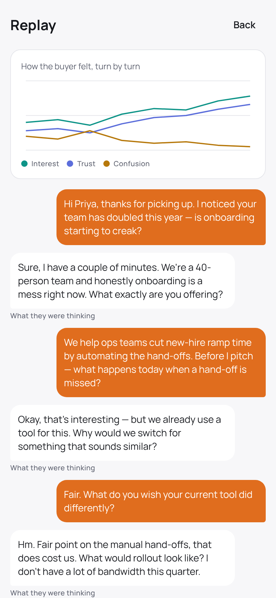
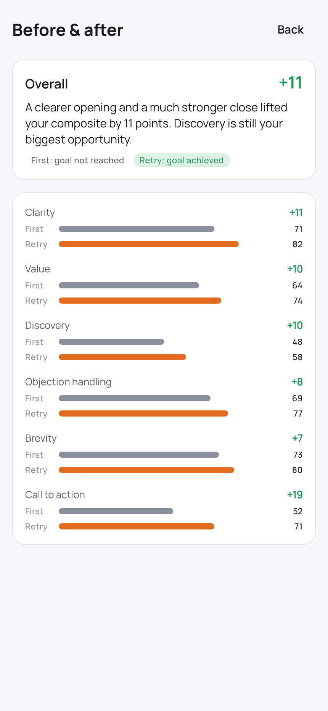

# DryRun

**A sales-practice simulator: describe what you sell, practice the hard conversation against an AI buyer built for your product, get an honest read on what's actually working.**

**Status:** API and background-worker backend implemented, with a test suite and CI. The Expo / React Native mobile client is built against it and covers the whole practice loop — auth, the live session, debrief, replay and retry comparison, progress, playbooks, billing, team management, notifications and a signed-out demo.

---

## What this is

You're a founder or a new sales hire and you're about to do outbound for the first time, or you have one specific hard conversation coming up — a skeptical buyer, a price objection, a prospect who's gone quiet. DryRun lets you practice that exact conversation, as many times as it takes, against a buyer persona generated from your actual product and audience — not a generic chatbot, and not a colleague who's tired of playing the villain.

A session runs in real time: the buyer's reply, their private internal monologue (revealed after the session), and a live interest/trust reading all update every turn from one structured AI call. When it ends, you get a six-axis skill score, a specific coaching debrief, and — if you retry the same scenario — an exact numeric comparison against your first attempt.

The backend — API, five background-job queues, AI provider fallback, billing, real-time status channels — and the mobile client that drives it live in one repository: `backend/` and `frontend/`.

## See it in action

<div align="center">

<table>
<tr>
<td align="center" valign="top"><br><sub><b>Live session</b><br>interest, trust and confusion move every turn</sub></td>
<td align="center" valign="top"><br><sub><b>Debrief</b><br>specific coaching and a six-axis score</sub></td>
<td align="center" valign="top"><br><sub><b>Replay</b><br>how the buyer felt, and what they were thinking</sub></td>
<td align="center" valign="top"><br><sub><b>Retry comparison</b><br>exact per-axis deltas against attempt one</sub></td>
</tr>
</table>

</div>

More screens (phone light and dark, tablet) are in [`docs/screenshots/`](./docs/screenshots/).

## The problem

Sales pitches fail in a specific, nameable way, and you usually only find out live, with a real prospect, when it's too late to try a different line. Role-playing with a colleague helps until they get tired of being the skeptical buyer. What's actually missing is a repeatable version of the hard conversation, with an honest read on what changed between attempts.

## What I actually built

- **A live-turn AI conversation engine** where every message exchange returns, in one validated structured response, an in-character reply, a private monologue, a signed interest/trust/confusion delta, buying-intent and objection-likelihood scores, and a goal-achievement judgment — with strict schema validation, a bounded retry on failure, and a neutral fallback if the retry also fails, so a malformed model response never reaches the user as a broken reply.
- **AI routed through a self-hosted [LLM gateway](https://github.com/Devpaul-01/llm-gateway)** that does multi-provider failover (Cerebras, Groq, OpenAI, …) per request, with an atomic per-workspace daily budget enforced via a Lua script, so two concurrent calls for the same workspace can't both slip past the budget check.
- **A persona-ingestion pipeline** that builds a buyer character from pasted text, a public URL, or an uploaded document (PDF/DOCX/image-via-OCR) — async extraction and synthesis, live status pushed over a Supabase Realtime channel that's authorized at the database layer, not just by what the API chooses to publish.
- **Five BullMQ queues, twenty-one job handlers, seven cron schedules** — debrief/scoring generation, skill-trend and curriculum recomputation, weekly summaries, renewal dunning, account purges, a cursor-paginated dead-letter feed merged correctly across all five queues using timestamp watermarks instead of a naive rank offset (which breaks under concurrent writes — this one doesn't).
- **A concurrency bug found and fixed at the database level**: message ordering used to race under concurrent requests for the same session; it's now an atomic Postgres RPC, not a client-side read-then-increment.
- **Request-level idempotency** via a claim-based Redis primitive (not a naive check-then-write, which has its own race condition) so a client retry after a dropped response can never double-submit a message or double-generate a playbook.
- **Billing reconciliation as a single atomic Postgres RPC** called identically from checkout confirmation and webhook processing, keyed on an exact transaction reference rather than "most recent pending subscription" — closing a real cross-tenant misattribution bug where one workspace's payment webhook could have activated a different workspace's subscription.

## Architecture, briefly

```
Mobile Client (Expo / React Native)
        │  HTTPS / JSON, Bearer JWT
        ▼
   Express API  ──┬──►  Supabase Postgres  (system of record)
        │          ├──►  Redis  (cache · rate limits · locks · queue state)
        │          └──►  Supabase Storage  (uploads)
        │
   enqueue jobs
        ▼
  5 BullMQ queues ──► workers ──► LLM gateway, Flutterwave, Expo Push, Resend
```

Three interchangeable startup modes from one codebase — `server.js` (API only), `jobs/index.js` (workers only), `start-all.js` (both, one process) — with zero duplicated logic between them.

Full write-up, including the AI validation pipeline, the sequence-index race and its fix, billing reconciliation, and the caching/invalidation design: **[ARCHITECTURE.md](./ARCHITECTURE.md)**.
Product workflows and the reasoning behind them: **[PRODUCT_OVERVIEW.md](./PRODUCT_OVERVIEW.md)**.

## Engineering highlights

- **Structured AI output is never trusted on receipt.** Zod-validated against strict numeric bounds; a validation failure triggers exactly one stricter retry, then falls back to a neutral response — every attempt, whatever the outcome, is logged to an evaluations table that backs the whole scoring-integrity story.
- **Prompt-injection defense is structural, not just a system-prompt instruction.** User content is delimited and labeled as data in every prompt, but the real second line of defense is that an injected instruction still has to survive strict schema/range validation to take effect.
- **Two genuinely different idempotency problems get two genuinely different fixes**: BullMQ job IDs for job-level dedup, a claim-based Redis primitive for request-level dedup — because a naive shared-cache check-then-write has the same race condition the budget check does, and both are fixed with the same atomic-Lua-script pattern.
- **Cache invalidation is tag-based where the affected key set is unbounded** (every cached page of a user's session list) and direct where it's known exactly (one persona's own cache entry) — one shared utility, not per-route reinvention.
- **Retries never regenerate the buyer.** An earlier version did, which meant a "before/after" comparison was silently comparing two different personas — fixed by explicitly carrying the original persona forward into the retry.
- **The privacy boundary between "my session" and "team aggregate" is structural.** The aggregate team-progress query is backed by a separate code path that never joins against the tables holding individual transcripts — an admin literally cannot query their way into a member's session content by accident, because the query that returns aggregates has no columns to leak it through.

## Tech stack

| Layer | Technology |
|---|---|
| Runtime | Node.js 20+, Express 4, TypeScript (strict mode) |
| Database | Supabase (Postgres), via `@supabase/supabase-js` — service-role client |
| Cache / queues / locks | Redis (`ioredis`), BullMQ |
| Validation | Zod |
| AI | [llm-gateway](https://github.com/Devpaul-01/llm-gateway) — OpenAI-compatible chat-completions; it fronts Cerebras, Groq, OpenAI and others |
| Auth | Supabase Auth (email/password + Google OAuth), JWT bearer tokens |
| File storage | Supabase Storage, signed upload/download URLs |
| Malware scanning | ClamAV (`clamscan`) |
| Payments | Flutterwave, behind a provider-agnostic interface |
| Push / email | Expo Server SDK, Resend / SMTP / console (env-selected) |
| Analytics | PostHog + a parallel Postgres `analytics_events` table |
| Logging / errors | Pino (structured JSON), Sentry |
| Mobile client | Expo / React Native, expo-router, TanStack Query, Zustand — see [`frontend/README.md`](./frontend/README.md) |

## Repository structure

```
backend/      Express + BullMQ API and worker service (TypeScript)
frontend/     Expo / React Native client (TypeScript, expo-router)
docs/         Longer-form documentation
.github/      CI: backend-ci.yml (typecheck, lint, build, test) and frontend-ci.yml
```

A guide to every document is in [`docs/README.md`](./docs/README.md).

Inside `backend/src/`:

```
config/       Supabase, Redis, env, logger, cache, system-config clients — single source per concern
jobs/         Queue registry, scheduler, 21 job handlers
lib/          Cross-cutting helpers: pagination, idempotency, ApiError
middleware/   requestId → securityHeaders → authenticate → resolveWorkspace → rateLimit → validate
modules/      One folder per domain (auth, billing, practice, coaching, files, ai, ...) —
              each with its own routes.ts / service.ts / schemas.ts
realtime/     Supabase Realtime channel publishing conventions
db/migrations/  Numbered, sequential SQL migrations (0001-0017) — the source of truth for the schema
db/schema.sql   Full current schema — generated by applying every migration and dumping the result,
                not hand-written; see the header comment in that file for how to regenerate it
app.ts        Express app assembly, route mounting, no listen()
server.ts     API-only entry point
start-all.ts  Combined API + worker entry point
```

## Setup

Backend (from `backend/`):

```bash
npm install
cp .env.example .env   # see required variables below
npm run dev             # API only, tsx watch
npm run dev:worker      # workers only
npm run dev:all         # both, one process
```

Mobile client (from `frontend/`, with the backend running):

```bash
npm install
cp .env.example .env   # set EXPO_PUBLIC_API_BASE_URL and the Supabase values
npm start
```

The database schema, Supabase Auth hook setup and the ClamAV dependency are covered in [`backend/README.md`](./backend/README.md).

### Required environment variables

```
SUPABASE_URL
SUPABASE_SERVICE_ROLE_KEY
REDIS_URL
```

These three are read lazily by `config/env.ts` — a missing one throws on the first Supabase or Redis call rather than at process start, so check `GET /health/ready` after booting. Everything else (AI gateway URL/key, Flutterwave keys, email provider, PostHog, Sentry, ClamAV host, `FRONTEND_URL`) is optional and feature-gates gracefully: the app boots without them, with the corresponding feature disabled (for AI, every AI call fails with `503 AI_UNAVAILABLE` until `GATEWAY_BASE_URL` and `GATEWAY_API_KEY` are set). The complete list, with defaults, is in [`docs/CONFIGURATION.md`](./docs/CONFIGURATION.md).

### Build & run

```bash
npm run build       # tsc → dist/
npm start            # node dist/server.js
npm run start:worker # node dist/jobs/index.js
npm run start:all    # node dist/start-all.js
```

## Testing and CI

| Suite | Command | What it covers |
|---|---|---|
| Backend — AI pipeline | `cd backend && npm test` | Every Zod schema in `modules/ai/outputValidator.ts` and the reject → retry → neutral-fallback control flow in `ai.service.ts`, with the provider call and Supabase mocked. No services needed. |
| Backend — billing reconciliation | `cd backend && npm test` | The `reconcile_successful_payment` RPC against a **real Postgres**, created and migrated from empty per run (needs `TEST_DATABASE_URL`; see [`backend/test/README.md`](./backend/test/README.md)). |
| Frontend | `cd frontend && npm test` | Jest (25 suites, 87 tests at the time of writing): the HTTP client's 401 refresh and 402 upgrade-gate handling, query-error mapping, stores, hooks and utilities, against MSW mocks. |
| Frontend — device smoke | `maestro test .maestro` | Login, a practice session through to the debrief, the demo funnel and settings; needs a device build and a seeded backend ([`frontend/.maestro/README.md`](./frontend/.maestro/README.md)). |

CI (`.github/workflows/`) runs typecheck, lint, build and tests for the backend — including a Postgres 16 service container for the billing suite — and typecheck, lint and Jest for the frontend. Maestro is manual.

## Current gaps, stated plainly

- **Backend test coverage is deliberately narrow.** The two suites above guard the places a silent regression would cost the most. There are no route-level or integration tests, and none of the 21 job handlers, the webhook route, the idempotency primitive or the cache layer has automated coverage yet.
- **Webhook events are not re-driven.** `POST /billing/webhooks/flutterwave` persists the event, answers `200`, and only then enqueues `process_webhook_event`. If that enqueue fails, the row stays `processed = false` and nothing sweeps for it. Details and mitigation in [`docs/BACKGROUND_JOBS.md`](./docs/BACKGROUND_JOBS.md#10-known-limitations).
- **No Dockerfile.** The three entry points run directly under Node.
- **RLS is enabled everywhere but isn't the enforcement boundary** — the service-role client bypasses it by design; workspace-scoping in application code is the real authorization check today, with RLS as a documented, deliberate last line of defense.
- **No license is declared.** `package.json` says `UNLICENSED`, so all rights are reserved by default.

## What's next

- Handler-level tests for the job queue, starting with the renewal-dunning chain and the webhook processor.
- A sweep that re-enqueues unprocessed `webhook_events` rows.
- A Dockerfile per entry point for real deployment.
