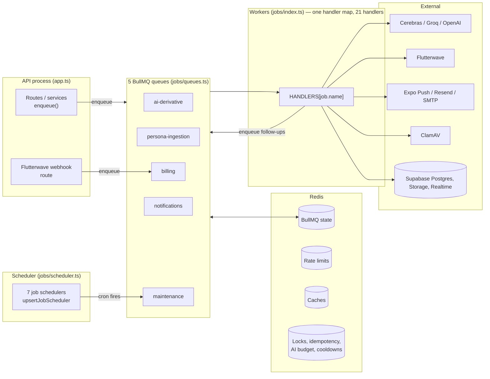
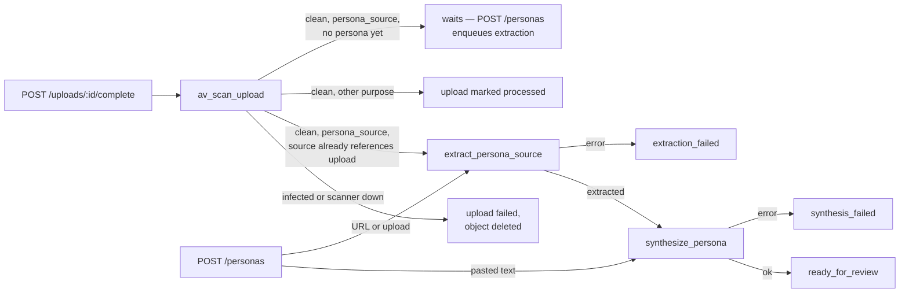

# Background Jobs & Asynchronous Processing

**Project:** DryRun — sales-practice simulator backend
**Scope:** The BullMQ queues, workers, scheduler and Redis coordination that run everything outside the HTTP request path, and every job handler that ships in this codebase.
**Audience:** Engineers operating, extending or reviewing the backend.

> This document describes the system as implemented in `backend/src/jobs/` and the call sites that enqueue into it. Where behaviour is a gap rather than a design choice, it is called out in [§10 Known Limitations](#10-known-limitations) instead of being described as if it were intended.

## Contents

1. [Overview](#1-overview)
2. [Architecture](#2-architecture)
3. [Queues and Workers](#3-queues-and-workers)
4. [Job Catalog](#4-job-catalog)
5. [Scheduler](#5-scheduler)
6. [Redis Usage](#6-redis-usage)
7. [Reliability](#7-reliability)
8. [Operating and Monitoring](#8-operating-and-monitoring)
9. [Adding a Job](#9-adding-a-job)
10. [Known Limitations](#10-known-limitations)

---

## 1. Overview

The Express API (`app.ts`) answers requests synchronously. Anything slow, external, bulk or time-driven is pushed onto **BullMQ** (Redis-backed) queues and handled by workers, so a slow AI provider, a malware scan or a data export never holds an HTTP connection open.

Three kinds of work live outside the request/response cycle:

1. **Deferred work triggered by a request.** Ending a session returns immediately; the debrief and skill scores are generated afterwards (`session.service.ts#endSession` → `generate_debrief` + `score_session_skills`). Uploads, persona synthesis, payment webhooks and data exports follow the same shape.
2. **Chained work triggered by another job.** Scoring enqueues skill-trend and curriculum recomputation; AV scanning enqueues extraction; extraction enqueues synthesis; a failed renewal enqueues its own next dunning attempt.
3. **Scheduled maintenance.** Seven cron schedules handle purges, archival, weekly summaries, a human-review sample and the daily renewal check.

The user-facing consequence of this split is that the client never waits on AI-derivative work. It either polls (`GET /sessions/:id/debrief` and `…/comparison`), listens to a Supabase Realtime channel (`session:{id}`, `persona:{id}`), or receives a push notification — see `realtime/channels.ts` and the frontend's polling hooks.

---

## 2. Architecture



**Key structural facts**

- **One handler map serves every queue.** `jobs/index.ts` builds a single `HANDLERS: Record<string, Handler>` keyed by job *name*, and every queue's worker looks its job up in that same map. Which queue a job runs on is decided only at the `enqueue()` call site (§3.3).
- **All seven schedules target `maintenance`.** `SCHEDULES` in `scheduler.ts` is typed to allow `maintenance` or `ai-derivative`, but every entry uses `maintenance`. Two of them (`dispatch_weekly_summaries`, `check_renewals_due`) are lightweight *dispatchers* that fan work out onto the `notifications` and `billing` queues rather than doing it themselves.
- **No scheduler process.** A schedule lives inside Redis once registered. The worker process registers all seven at startup; nothing needs to be running at fire time other than a worker consuming `maintenance`.

---

## 3. Queues and Workers

### 3.1 Entry points

| Entry | Starts | Use |
|---|---|---|
| `server.ts` (`npm start`) | HTTP API only | Production, API tier |
| `jobs/index.ts` (`npm run start:worker`) | All 5 workers + schedule registration, no HTTP | Production, worker tier |
| `start-all.ts` (`npm run start:all`) | API + all 5 workers, one process | Local dev, staging, small deployments |

`start-all.ts` imports `startAllWorkers()` and `shutdownWorkers()` from `jobs/index.ts` rather than duplicating them. `jobs/index.ts`'s own `main()` is guarded by `require.main === module`, so importing it does not start a second set of workers or register a second set of signal handlers.

**Shutdown ordering.** All three entry points handle `SIGTERM`/`SIGINT`. In combined mode (`start-all.ts`) the HTTP listener closes first so no new request can enqueue a job, then the workers are closed (which waits for in-flight jobs), then PostHog is flushed. Closing workers first could let a request enqueue a job that no worker will ever pick up. The standalone worker (`jobs/index.ts`) closes its workers and exits; it does not flush PostHog.

### 3.2 The five queues

Declared in `jobs/queues.ts` (`QueueName`, `QUEUE_NAMES`). They are separate queues, not one generic queue, because their retry and priority needs differ: billing correctness matters more than throughput, notifications are cheap and high-volume, and AI-derivative work sits in between.

| Queue | Worker concurrency | Attempts | Backoff (exponential) | `removeOnComplete` | `removeOnFail` | Carries |
|---|---|---|---|---|---|---|
| `ai-derivative` | 8 | 3 | 5 s base | keep last 500 | keep last 1000 | Debriefs, scoring, skill trend, curriculum, consistency check, summarisation |
| `persona-ingestion` | 6 | 3 | 5 s base | keep last 500 | keep last 1000 | AV scan, source extraction, persona synthesis |
| `billing` | 3 | 5 | 10 s base | keep last 2000 | keep last 5000 | Webhook processing, renewal charges |
| `notifications` | 15 | 3 | 3 s base | keep last 1000 | keep last 500 | Weekly summaries, payment-failed email |
| `maintenance` | 2 | 3 | 5 s base | keep last 100 | keep last 200 | Purges, archival, sampling, export, both scheduled dispatchers |

- BullMQ's exponential backoff doubles per retry (`delay × 2^(attempt−1)`), so `ai-derivative` retries after about 5 s and then 10 s; `billing` retries after 10, 20, 40 and 80 s.
- Billing has its own dunning schedule on top of this — see `attempt_renewal_charge` in §4.4. The queue-level `attempts: 5` bounds retries of *webhook processing*, as the comment in `queues.ts` says.
- Concurrency is per worker process. Three worker processes give three times these numbers.
- Billing's low concurrency is deliberate. Because it is its own queue with its own worker, an AI-derivative backlog cannot delay a renewal charge in the queue (within one Node process the workers still share an event loop).

### 3.3 Enqueueing

Every call site uses the one `enqueue(queueName, jobName, data, options)` function in `jobs/queues.ts`. It merges the queue's default options (the table above) with per-call options and, when `options.idempotencyKey` is given, uses it as the BullMQ **job ID**. BullMQ ignores an `add()` for a job ID that already exists, which is how job-level deduplication works here (§7.2).

`getQueue(name)` lazily creates and caches one `Queue` per name for the life of the process. Its parameter is typed as `QueueName`, so a typo is a compile error. The one place a queue name arrives as an untyped string — the admin retry endpoint — is validated against `QUEUE_NAMES` in `retryJob()` before `getQueue` is called, so a mistyped name returns a clear `400` instead of silently creating a new Redis-backed queue.

### 3.4 Worker execution

`startWorker(queueName)` in `jobs/index.ts` creates a BullMQ `Worker` for the queue with the concurrency above. For each job it:

1. looks up `HANDLERS[job.name]`;
2. if none is registered, logs `No handler registered for job` and **returns normally** (the job is marked completed and dropped — see §10);
3. otherwise awaits the handler, then logs `Job completed` with `queueName`, `jobName`, `jobId` and `durationMs`.

The only worker event listener is `failed`, which logs `queueName`, `jobName`, `jobId` and the error.

Handlers are thin. They take the job payload and delegate to a service function (`runDebriefGeneration`, `recomputeSkillTrendForUser`, …) that the HTTP layer can also call. This is the same "services take plain parameters, never `req`/`res`" rule the API follows.

---

## 4. Job Catalog

All 21 handlers, registered in `HANDLERS` in `jobs/index.ts`. Job names are `snake_case` strings; the queue is fixed by the call site that enqueues them.

| Job | Queue | Triggered by | Idempotent? |
|---|---|---|---|
| [`generate_debrief`](#41-ai-derivative) | ai-derivative | `endSession` | Yes — upsert on `session_id` (re-runs re-spend AI budget) |
| [`score_session_skills`](#41-ai-derivative) | ai-derivative | `endSession` | Yes — upsert on `session_id` |
| [`recompute_skill_trend`](#41-ai-derivative) | ai-derivative | after `score_session_skills` | Appends a snapshot row per run |
| [`recompute_curriculum`](#41-ai-derivative) | ai-derivative | after `score_session_skills` | Supersede-then-insert (two statements) |
| [`run_async_scoring_consistency_check`](#41-ai-derivative) | ai-derivative | every live turn | Yes — sets a flag |
| [`summarize_conversation`](#41-ai-derivative) | ai-derivative | every 30th message | Yes — delete-then-insert, duplicate key tolerated |
| [`av_scan_upload`](#42-persona-ingestion) | persona-ingestion | upload-complete | Yes — status transitions |
| [`extract_persona_source`](#42-persona-ingestion) | persona-ingestion | `POST /personas` with a URL or upload source; or `av_scan_upload` when a persona source already references the upload | Yes — overwrites extracted text |
| [`synthesize_persona`](#42-persona-ingestion) | persona-ingestion | after extraction; or `POST /personas` with pasted text | Guarded by optimistic concurrency |
| [`process_webhook_event`](#43-billing) | billing | Flutterwave webhook route | Yes — `processed` flag + atomic RPC |
| [`attempt_renewal_charge`](#43-billing) | billing | `check_renewals_due`, or its own dunning retry | Lock + dispatch key; **see §10** |
| [`send_payment_failed_email`](#44-notifications) | notifications | failed webhook payment | No |
| [`send_weekly_summary`](#44-notifications) | notifications | `dispatch_weekly_summaries` | No |
| [`purge_expired_demo_sessions`](#45-maintenance) | maintenance | cron, hourly | Yes — delete by predicate |
| [`purge_soft_deleted_accounts`](#45-maintenance) | maintenance | cron, daily | Lock with heartbeat |
| [`purge_orphaned_uploads`](#45-maintenance) | maintenance | cron, hourly (:30) | Yes — delete by predicate |
| [`archive_old_session_state_snapshots`](#45-maintenance) | maintenance | cron, weekly | Yes — delete by predicate |
| [`sample_ai_scoring_evaluations_for_review`](#45-maintenance) | maintenance | cron, weekly | Yes — only unsampled rows considered |
| [`export_user_data`](#45-maintenance) | maintenance | `GET /user/export` | No — each run writes a new file and sends an email |
| [`dispatch_weekly_summaries`](#45-maintenance) | maintenance | cron, weekly | No — fan-out is not deduplicated |
| [`check_renewals_due`](#45-maintenance) | maintenance | cron, daily | Yes — dispatch key per subscription and period end |

### 4.1 `ai-derivative`

**`generate_debrief`** — payload `{ sessionId, workspaceId }`.
Builds the transcript, asks the model for a strength, an improvement and a coachable moment, and upserts `session_debriefs` (`onConflict: 'session_id'`). Then publishes `debrief_ready` on the `session:{id}` Realtime channel and, if the user's `async_ready_push_enabled` preference is on, sends a push notification.

**`score_session_skills`** — payload `{ sessionId, workspaceId }`.
Generates six axis scores (clarity, value, discovery, objection handling, brevity, CTA strength), computes the composite as their plain mean, and upserts `session_skill_scores`. Side effects, in order: publish `scoring_ready`; `checkAndAwardBadges`; enqueue `recompute_skill_trend` and `recompute_curriculum`; and, when the session is a retry (`retry_of_session_id` set), compute the before/after comparison and upsert it into `session_retries`. If the original session is not scored yet the comparison is skipped, and `GET /sessions/:id/comparison` recomputes it on demand.

**`recompute_skill_trend`** — payload `{ userId, workspaceId }`.
Averages the composite score over the user's last 30 scored sessions in the workspace and **inserts** a new `user_skill_trend` snapshot row (it does not update one), then invalidates the cached trend. Anything computable is computed in code; no AI call.

**`recompute_curriculum`** — payload `{ userId, workspaceId }`.
Finds the user's weakest axis and any core scenario type not practised recently, marks the user's `active` plan `superseded`, and inserts a new `active` plan that expires after seven days. The supersede and the insert are two separate statements, not one transaction.

**`run_async_scoring_consistency_check`** — payload `{ evaluationId }`.
A cheap, rule-based monitor, deliberately not a second AI call. It reads the founder's message from `ai_scoring_evaluations.raw_response`, does a keyword tone read, and sets `flagged_for_review` when the model's interest delta disagrees sharply with the tone (negative tone with delta above +8, or positive tone with delta below −8). It flags and never blocks. Enqueued after every live turn.

**`summarize_conversation`** — payload `{ sessionId, workspaceId, upToSequenceIndex }`.
Enqueued from `sendMessage` when the session's message count reaches a multiple of 30. The live-turn prompt only ever carries the most recent 20 messages; this job compresses everything older into a summary of under 120 words, which later turns prepend as a synthetic note. It deletes the session's previous summary and inserts the new one; a unique-violation (`23505`) from a concurrent run is treated as success. **Raw messages are never edited or deleted** — only what is sent to the model changes.

### 4.2 `persona-ingestion`

These three form a pipeline. Each stage publishes a status on the `persona:{id}` Realtime channel and enqueues the next.



**`av_scan_upload`** — payload `{ uploadId, workspaceId }`.
Downloads the object from Storage and scans it with ClamAV. An infected file **or an unreachable scanner** marks the upload `failed` / `av_scan_status: flagged` and deletes the object — the scan fails closed. A clean upload of any purpose other than `persona_source` is marked `processed`. A clean `persona_source` upload enqueues extraction only if a `persona_sources` row already references it; in the usual client flow the upload is scanned first and the later `POST /personas` request is what enqueues extraction (see §10 for the ordering this relies on).

**`extract_persona_source`** — payload `{ personaId, personaSourceId, workspaceId, scenarioType?, sourceKind }`.
Extracts text per source kind (PDF, DOCX, public URL, or image via a vision model; any other MIME type is read as UTF-8 and truncated to 20,000 characters), flags likely PII with a simple email/phone regex, stores `extracted_text`, publishes `extracted`, and enqueues synthesis. Any error is caught inside the handler: the source is marked `extraction_failed`, the upload (if any) `failed`, and an `extraction_failed` status with a "try pasting the text directly" message is published. The handler does not rethrow, so BullMQ does not retry it.

**`synthesize_persona`** — payload `{ personaId, personaSourceId, workspaceId, scenarioType? }`.
Resolves the initiating user from the persona row (`created_by_user_id`), so a multi-member workspace never grounds a persona in another member's product description. Generates the persona fields and writes them with a conditional update (`.eq('updated_at', capturedUpdatedAt)`). If the user edited the placeholder while synthesis ran, the update matches no rows and the worker skips its own write rather than overwriting the edit. Errors are caught, set `generation_status: 'failed'`, and publish `synthesis_failed`; this handler does not rethrow either.

### 4.3 `billing`

**`process_webhook_event`** — payload `{ webhookEventId }`.
Loads the stored `webhook_events` row and returns if it is already `processed`. It then **re-verifies the transaction with Flutterwave** (the webhook body alone is never trusted as proof of payment) and finds the subscription by the exact `pending_tx_ref` stored at checkout creation — not by recency, which used to allow one workspace's payment to activate another workspace's subscription. A successful payment goes through the atomic `reconcile_successful_payment` RPC (activate the subscription, record the transaction, write the audit entry together). A failed one enqueues `send_payment_failed_email`. The event is marked `processed` last. If the RPC errors, the handler throws and BullMQ retries — the event is deliberately not marked processed.

**`attempt_renewal_charge`** — payload `{ subscriptionId, dunningAttempt?, firstFailedAt? }`.
DryRun, not Flutterwave, initiates every recurring charge: the charge is a tokenised card re-charge, and nothing on the provider side renews automatically.

1. Take the lock `renewal-lock:{subscriptionId}` (`SET NX PX 30000`). If it is held, log and return — this prevents a double charge when a scheduled run and a manual admin retry overlap.
2. Read the plan price, the workspace owner's email and the last successful `card_token`; call `chargeRenewal`.
3. On success, call `reconcile_successful_payment` with the period extended by one month.
4. On failure (no card token, no owner email, or a declined charge): set the subscription `past_due`, email the owner, and schedule the next attempt.

Dunning is an **absolute** schedule from the first failure: `firstFailedAt` is captured once and threaded through every retry payload, and each delay is `firstFailedAt + N days − now`, with `N` taken from `[1, 4, 8]`. So the attempts happen on day 0, 1, 4 and 8, and the failure of the day-8 attempt sets the subscription `canceled` and writes `subscription_canceled_dunning_exhausted` to the audit log. The offsets are chosen so cancellation lands at or before the 10-day `PAST_DUE_GRACE_DAYS` window in `entitlements.ts`; an earlier version computed each delay from dispatch time, drifted to roughly day 11, and downgraded the workspace before dunning finished. The lock is always released in `finally`.

### 4.4 `notifications`

**`send_payment_failed_email`** — payload `{ workspaceId }`. Emails the workspace owner through `notify()`. Not deduplicated.

**`send_weekly_summary`** — payload `{ userId, workspaceId }`. Skips users with `weekly_summary_enabled = false`, and skips (sends nothing) when the user completed no sessions in the last seven days. Otherwise gathers sessions, days active, this-week and last-week composite scores, strongest and weakest axis, goals set and achieved, new badges, the best coachable moment and the current curriculum focus, and emails them. A data-gathering error is logged and the job returns without sending.

### 4.5 `maintenance`

| Job | What it does |
|---|---|
| `purge_expired_demo_sessions` | Deletes `demo_sessions` rows past `expires_at`. |
| `purge_soft_deleted_accounts` | Hard-deletes users whose `deleted_at` is older than the 14-day grace window. Holds `purge-soft-deleted-accounts-lock` (5 min TTL, refreshed with `PEXPIRE` after each candidate, so a batch that is making progress keeps its lock). Skips a user who is still the owner of a workspace that has other active members. Otherwise deletes the user row and the Supabase Auth user, defensively cancels subscriptions on workspaces they solely owned, and deletes those workspaces. Failures are logged as `ALERT` and rethrown. |
| `purge_orphaned_uploads` | Deletes `uploads` rows still in `uploaded` status 24 hours after creation (a signed URL was issued but `complete` was never called) and their Storage objects. |
| `archive_old_session_state_snapshots` | For sessions completed more than 180 days ago **that already have both a debrief and skill scores**, deletes the per-turn `session_state_snapshots` rows. The aggregates are permanent; the raw detail is not. Processes up to 500 sessions per run. |
| `sample_ai_scoring_evaluations_for_review` | Picks up to 25 random `ai_scoring_evaluations` from the last seven days not yet sampled and marks them `sampled_for_human_review`, feeding `GET /admin/ai-scoring/sample`. It only builds the queue; it has no value unless someone reads it. |
| `export_user_data` | Payload `{ userId }`. Collects the user's own data — profile, practice profiles, sessions and every child table that holds their content (messages, debriefs, scores, goals, summaries, snapshots, retries), personas and their sources, playbooks and versions, curriculum, badges, skill trend, notification preferences, push tokens, uploads — writes it as JSON to `exports/{userId}-{timestamp}.json` in Storage, and emails a signed URL valid for 7 days. Workspace-level tables (subscriptions, payments, members) are deliberately excluded because they contain other people's data. |
| `dispatch_weekly_summaries` | Enqueues one `send_weekly_summary` job per active `workspace_members` row whose user is not soft-deleted, so each send retries independently and the scheduled job stays cheap. |
| `check_renewals_due` | Runs two disjoint queries. **Due renewals** (`status = 'active'`, `canceled_at` null, `current_period_end` in the past) are dispatched to `attempt_renewal_charge` with `idempotencyKey = renewal-dispatch:{subscriptionId}:{current_period_end}`. **Cancelled and expired** subscriptions (`canceled_at` set, period over) are finalised to `canceled` with an audit entry and no charge. Query errors are logged as `ALERT` and rethrown. |

---

## 5. Scheduler

### 5.1 Registered schedules

All seven live in `SCHEDULES` in `jobs/scheduler.ts` and all are registered on the `maintenance` queue. The job name doubles as the scheduler ID.

| Job | Cron | When | Meaning |
|---|---|---|---|
| `purge_expired_demo_sessions` | `0 * * * *` | Hourly, :00 | Delete expired signed-out demo sessions |
| `purge_orphaned_uploads` | `30 * * * *` | Hourly, :30 | Delete uploads that were never confirmed |
| `check_renewals_due` | `0 2 * * *` | Daily 02:00 | Dispatch renewal charges; finalise cancelled subscriptions |
| `purge_soft_deleted_accounts` | `0 3 * * *` | Daily 03:00 | Hard-delete accounts past the 14-day grace window |
| `archive_old_session_state_snapshots` | `0 4 * * 0` | Sunday 04:00 | Prune per-turn snapshots older than 180 days |
| `sample_ai_scoring_evaluations_for_review` | `0 5 * * 1` | Monday 05:00 | Draw the weekly human-review sample |
| `dispatch_weekly_summaries` | `0 18 * * 0` | Sunday 18:00 | Fan out one summary email job per active member |

No `tz` is set on any schedule, so the patterns are evaluated in the worker process's timezone — UTC in most containers. Set `TZ` explicitly if the times matter.

### 5.2 Registration

`registerSchedules()` runs inside `startAllWorkers()`, so every worker process and every combined-mode process calls it on boot. For each entry it calls BullMQ's `queue.upsertJobScheduler(jobName, { pattern: cron }, { name: jobName, data })`.

That call is one atomic server-side operation ("create this scheduler, or update it in place if the ID exists"), so any number of replicas can boot at once without racing. It replaced BullMQ's deprecated repeatable-jobs API (`getRepeatableJobs` → `removeRepeatableByKey` → `add`), whose non-atomic read-delete-add sequence had needed a hand-rolled Redis lock around it. The lock was removed outright because the problem it solved no longer exists.

Two consequences to be aware of:

- The schedule lives in Redis, not in a running process. When a cron fires, BullMQ creates the job on `maintenance` and any worker consuming that queue picks it up.
- Registration only ever *upserts*. Deleting an entry from `SCHEDULES` does not remove its scheduler from Redis; remove it explicitly (§9).

The scheduler passes no job `opts`, so scheduled jobs do not get the per-queue retry and retention defaults from §3.2. This matters for reliability — see §7.1 and §10.

---

## 6. Redis Usage

One shared `ioredis` connection (`config/redis.ts`, created lazily, `maxRetriesPerRequest: null` as BullMQ requires) backs seven distinct concerns. Nothing in the backend talks to Redis outside these.

| # | Concern | Where | Keys and mechanism |
|---|---|---|---|
| 1 | **Queues and scheduler** | `jobs/*` | BullMQ's own key space. |
| 2 | **Rate limiting** | `middleware/rateLimit.ts` | `ratelimit:{baseUrl}{path}:{identity}:{windowBucket}`, `INCR` then `EXPIRE` on the first hit. Fixed window, counted **per route**, keyed by user ID or IP. Eight tiers — see ARCHITECTURE.md §11. |
| 3 | **Caches** | `config/cache.ts`, `middleware/resolveWorkspace.ts`, `config/systemConfig.ts` | Read-through cache with direct-key and tag-set invalidation (tag sets expire after 24 h as a backstop); workspace context cached 30 s; `system_config` values cached 30 s. |
| 4 | **AI provider cooldown** | `modules/ai/fallbackChain.ts` | `ai-provider-cooldown:{provider}`, set for 1 hour when a provider fails with a retryable error. |
| 5 | **AI budget** | `modules/ai/fallbackChain.ts`, `config/redis.ts` | `ai-budget:{workspaceId}:{day}`, reserved by the `checkAndReserveBudget` **Lua script** so read, compare and increment are one atomic step. |
| 6 | **Request idempotency** | `lib/idempotency.ts`, `config/redis.ts` | `idempotency:{scope}:{key}`. The `claimIdempotencyKey` Lua script atomically claims the key for 30 s; the winner runs the work and caches its result for 24 h, while a losing caller polls for that result instead of running the work again. A failed attempt clears its own claim at once. |
| 7 | **Locks and counters** | `attemptRenewalCharge.worker.ts`, `purgeSoftDeletedAccounts.worker.ts`, `modules/demo/demo.service.ts` | `renewal-lock:{subscriptionId}` (`SET NX PX 30000`); `purge-soft-deleted-accounts-lock` (`SET NX PX 300000`, refreshed after each candidate); `demo-abuse:{sha256(ip)}` (`INCR`, 24 h) allowing one demo per IP per day. |

**Why two of these are Lua scripts and the rest are not.** A single `INCR` or `SET NX` is already atomic. The AI budget and the idempotency claim were different: they did a plain read followed by a *conditional* write based on what was read, so two concurrent callers — on one instance or on two — could both pass the check. Moving the read, compare and write into one script closes that.

**Failure behaviour is not uniform, and mostly fails closed.** Only the shared read-through helper `cached()` in `config/cache.ts` catches Redis errors and falls through to Postgres. The workspace-context lookup (`resolveWorkspace`), `system_config` reads (`getConfig`) and the rate limiter have no such fallback: a Redis error is forwarded to the error handler, so while Redis is unreachable every authenticated route (which runs `resolveWorkspace` and `defaultRateLimit`) returns a 5xx. Enqueueing a job needs Redis too. Treat Redis as a hard dependency of the API, not an optional accelerator.

**What Redis is not used for:** pub/sub (Realtime goes through Supabase), Streams, Redlock, or any dead-letter store beyond BullMQ's own failed-job sets.

---

## 7. Reliability

### 7.1 What actually gets retried

The per-queue retry settings in §3.2 are applied by `enqueue()`. Three things reduce how much of that applies in practice:

- **Scheduled jobs get none of it.** The scheduler passes no job options (§5.2), so the seven cron-fired jobs run with BullMQ's defaults for an option-less job: a single attempt, and completed and failed job records are not automatically removed. A failure in `check_renewals_due` is therefore retried by the next day's run, not by BullMQ.
- **Several handlers catch their own failures.** `extract_persona_source` and `synthesize_persona` mark the persona or source as failed, publish a status and return; the AV scanner marks the upload failed and returns. Because they do not throw, the `persona-ingestion` queue's three attempts never apply to them — the failure is *terminal* and is surfaced to the user as a status instead. This is deliberate for user-visible pipelines (a retry would only delay the failure message) but means the queue-level retry count is not the whole story.
- **Handlers that rethrow** — `process_webhook_event` when the reconcile RPC fails, `purge_soft_deleted_accounts` and `check_renewals_due` on query errors, `attempt_renewal_charge` on a reconcile error — do get BullMQ retries when they were enqueued through `enqueue()`.

### 7.2 Duplicate prevention

| Problem | Mechanism |
|---|---|
| Two renewal dispatches for the same subscription and billing period | Job ID `renewal-dispatch:{subscriptionId}:{current_period_end}` from `enqueue({ idempotencyKey })`. BullMQ ignores an `add()` whose ID exists. Once a renewal succeeds, `current_period_end` advances, so the next period gets a new ID. |
| A scheduled run and a manual admin retry charging at once | `renewal-lock:{subscriptionId}` (30 s). |
| A webhook delivered twice | `webhook_events.provider_event_id` unique constraint (`23505` is answered `200`); `processed` flag checked again in the worker; atomic `reconcile_successful_payment` RPC. |
| Re-running a scoring, debrief or comparison job | Upserts keyed on `session_id` / `retry_session_id`. |
| Concurrent summarisation | Delete-then-insert with `23505` treated as success. |
| Overwriting a user's edit with a stale persona synthesis | Conditional update on `updated_at` (§4.2). |
| Two replicas running the account purge | `purge-soft-deleted-accounts-lock` with a refreshed TTL. |
| A client retrying `POST /sessions/:id/messages` or playbook generation | Request-level idempotency via the `Idempotency-Key` header (`lib/idempotency.ts`, Redis Lua claim) — this protects the HTTP request, not the job. |
| Two replicas registering the same cron schedule | `upsertJobScheduler` (§5.2). |

Only `attempt_renewal_charge` dispatch uses a deterministic job ID today. Everything else enqueued from the API gets a random BullMQ ID, so an API-level retry that reaches `enqueue()` twice would enqueue twice and rely on the handler being re-runnable.

### 7.3 Failure recovery

There is **no dead-letter queue and no automated re-drive**. A job that exhausts its attempts stays in its queue's failed set (capped by `removeOnFail`, §3.2) where an admin can see and retry it (§8). What recovers on its own:

| Failure | Recovery |
|---|---|
| A cron-fired job fails | The next scheduled run. All seven are written to be safe to run again. |
| A renewal charge is declined | The dunning chain: attempts on day 0, 1, 4 and 8, then cancellation. |
| A conversation summary fails | The next 30-message boundary produces a newer one. |
| An AI provider fails | Not a job concern: the provider fallback chain in `modules/ai/fallbackChain.ts` tries the next provider, with a 1-hour cooldown on the failing one. |
| Webhook persistence fails | The route answers `500`, so Flutterwave redelivers. (Processing failures *after* a successful insert are different — see §10.) |

### 7.4 Crash recovery and shutdown

If a worker dies mid-job, BullMQ's lock on the job lapses and the job is reclaimed as stalled and run again by a live worker. Handlers must therefore tolerate a second run, and the table in §4 says which do. The three that do not — `export_user_data`, `send_weekly_summary`, `send_payment_failed_email` — could send a duplicate email after a crash; `attempt_renewal_charge` is a more serious case and is covered in §10.

On `SIGTERM`/`SIGINT` the worker calls `close()` on every `Worker`, which stops taking new jobs and waits for in-flight ones. There is no forced-exit timer, so a handler that never returns holds the process open until the orchestrator sends `SIGKILL`.

No worker sets `lockDuration` or a per-job timeout, so BullMQ's defaults apply. External calls rely on the HTTP client's and provider's own timeouts.

---

## 8. Operating and Monitoring

### 8.1 Running

```bash
# Production, split tiers (after `npm run build`)
npm start                # API only          -> node dist/server.js
npm run start:worker     # workers + schedules -> node dist/jobs/index.js
npm run start:all        # both in one process -> node dist/start-all.js

# Development (tsx watch)
npm run dev              # API only
npm run dev:worker       # workers only
npm run dev:all          # both
```

Run as many `start:worker` processes as needed against the same `REDIS_URL`; BullMQ hands each job to exactly one. Concurrency in §3.2 is per process. Every worker process re-registers the schedules on boot, which is safe (§5.2). Do not use `start:all` if API and worker capacity need to scale independently.

### 8.2 Admin endpoints

Mounted at `/api/v1/admin`; every route requires an authenticated user with the `is_admin` flag, plus the optional `ADMIN_ALLOWLIST_IPS` check (see [CONFIGURATION.md](./CONFIGURATION.md)).

| Endpoint | Purpose |
|---|---|
| `GET /jobs` | Per-queue counts of `waiting`, `active`, `failed` and `delayed` jobs. Also what `GET /health/deep` returns (admin-only). |
| `GET /jobs/dead-letter?cursor=&limit=` | Failed jobs from **all five queues merged** into one most-recent-first feed, with `queue`, `id`, `name`, `failedReason`, `failed_at` and `attempts_made`. The cursor is a per-queue timestamp watermark rather than a rank offset, so new failures arriving mid-walk cannot cause duplicated or skipped entries (`jobs/deadLetterPagination.ts`). |
| `POST /jobs/:id/retry` | Body `{ "queue": "<name>" }`. Validates the name against the five real queues (`400` otherwise), finds the job (`404` if absent) and calls BullMQ's `retry()`. Rate-limited. |
| `GET /ai-scoring/sample` | The weekly human-review sample built by `sample_ai_scoring_evaluations_for_review`. |

`GET /health/ready` is the unauthenticated readiness probe (pings Postgres and Redis).

### 8.3 Logging and alerting

Pino structured logs. Each worker logs `Job completed` (`queueName`, `jobName`, `jobId`, `durationMs`) on success and logs the error on `failed`. Critical paths prefix their message with `ALERT:` — failed webhook persistence, webhook processing, renewal charging and dispatch, and the account purge — so a log-based alert on that substring covers the cases that cost money or lose data.

**Sentry is not wired into the workers.** It is initialised in `app.ts` and called from the Express error handler, so only HTTP errors reach it. A failing job appears in the logs and the admin feed, nowhere else.

### 8.4 Debugging a failed job

1. `GET /api/v1/admin/jobs/dead-letter` — find the job's queue, ID, name and `failedReason`.
2. Search logs for its `jobId`, or for `ALERT:`, to see the surrounding context.
3. For billing, look at the `webhook_events` row (`processed`, `payload`) and the `subscriptions` row (`status`, `pending_tx_ref`, `current_period_end`) directly.
4. For persona or upload problems, read the `generation_status`, `persona_sources.status` and `uploads.status` / `av_scan_status` columns — these are the user-visible state the handlers write.
5. Fix the cause, then `POST /api/v1/admin/jobs/:id/retry`. Check the "Idempotent?" column in §4 first: do not blindly retry `attempt_renewal_charge` or an email job.

---

## 9. Adding a Job

1. **Write the logic as a service function** in the relevant `modules/*` folder, taking plain parameters. The worker handler should only unpack `job.data` and call it.
2. **Add a handler file** under `jobs/workers/` and register it in the `HANDLERS` map in `jobs/index.ts`. The key is the job name.
3. **Pick the queue.** Reuse one of the five (§3.2) unless the new work needs different retry, retention or concurrency; a new queue means adding it to `QueueName`, `QUEUE_NAMES` and `DEFAULT_JOB_OPTIONS` in `jobs/queues.ts`, to `QUEUE_CONCURRENCY` in `jobs/index.ts`, and to the separate `QUEUE_NAMES` list in `jobs/deadLetterPagination.ts` so its failures show up in the admin feed.
4. **Enqueue with `enqueue(queue, name, data, options)`** — not `getQueue().add()` — so the queue defaults apply. Pass `idempotencyKey` if two enqueues for the same logical work are possible.
5. **Make the handler safe to run twice** (upsert, conditional update, or a guard), and decide deliberately whether it should throw (get retried) or record a terminal failure and return.
6. **To schedule it**, add an entry to `SCHEDULES` in `jobs/scheduler.ts`. Remember that scheduled jobs get no retry options (§5.2). To *remove* a schedule, also call `upsertJobScheduler`'s counterpart `removeJobScheduler(jobName)` once against the live Redis; deleting the entry alone leaves the old scheduler firing.

---

## 10. Known Limitations

These are gaps found while documenting the system, not design choices. Each is traced to the code named.

1. **Webhook events are not re-driven if the enqueue fails.** `webhook.routes.ts` inserts the `webhook_events` row, answers `200`, and *then* awaits `enqueue('billing', 'process_webhook_event', …)`. If the enqueue fails (Redis blip), the row stays `processed = false` and nothing sweeps for such rows. A redelivery from Flutterwave hits the unique constraint, is treated as a duplicate and answered `200` without being processed. A periodic job that re-enqueues old unprocessed `webhook_events` would close this.

2. **`attempt_renewal_charge` can charge a card more than once on retry.** `chargeRenewal` builds a fresh `tx_ref` from `Date.now()` on every call, so each call is a new charge. If the provider charge succeeds but `reconcile_successful_payment` then errors, the handler throws, and because the job was added through `enqueue('billing', …)` it carries `attempts: 5` — BullMQ re-runs it, and the re-run charges again. The handler's own comment says this case must raise an alert rather than be lost; the retry configuration works against the "must not run again" half. Derive the `tx_ref` from `subscriptionId` and `current_period_end` (so a retry verifies the existing charge), or enqueue renewals with `attempts: 1`.

3. **A job with an unknown name completes silently.** The worker logs `No handler registered for job` and returns, so BullMQ records success. A renamed job or a stale enqueue disappears without a failure.

4. **Scheduled jobs have one attempt and unbounded history.** See §5.2 and §7.1. Passing `opts` in the scheduler template (`attempts`, `backoff`, `removeOnComplete`, `removeOnFail`) would apply the per-queue policy; today the hourly purges alone add about 48 retained completed-job records a day.

5. **Observability is thin.** Workers listen only for `failed` (not `error` or `stalled`), emit no metrics, and do not report to Sentry (§8.3). There is no alert on "a scheduled job did not run".

6. **Upload scan ordering is not enforced.** `POST /personas` with an upload source enqueues extraction immediately, and `extract_persona_source` does not check `uploads.av_scan_status`. The intended client flow completes (and scans) the upload first, but a request that creates the persona before the scan finishes would parse an unscanned file, and the scanner would then enqueue a second extraction when it completes.

7. **A failed data export is silent.** If writing the export file to Storage fails, `export_user_data` logs and returns without throwing or notifying the user, although `GET /user/export` told them they would be notified.

8. **Not re-run safe:** `export_user_data`, `send_weekly_summary`, `send_payment_failed_email` and `dispatch_weekly_summaries` have no deduplication; `recompute_skill_trend` appends a row per run; `recompute_curriculum`'s supersede and insert are separate statements, so two concurrent runs for the same user can leave two `active` plans.

9. **Redis is a hard dependency** of the API as well as the workers (§6).

10. **No forced shutdown timeout** (§7.4).
