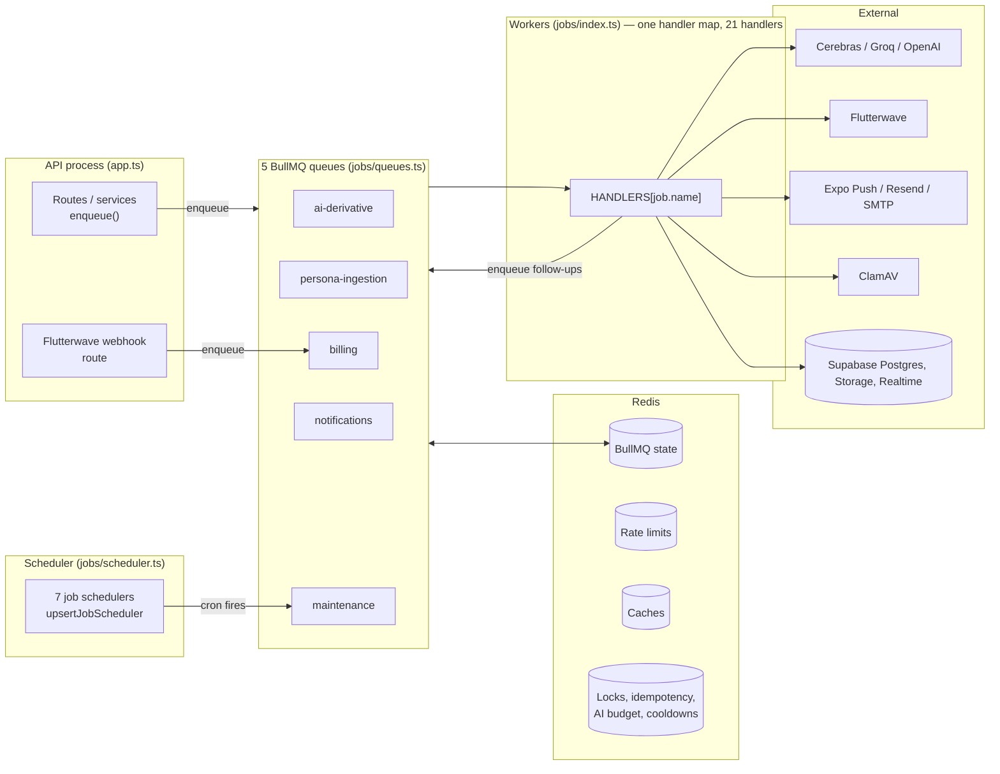

# Background Jobs & Asynchronous Processing

**Project:** DryRun — sales-practice simulator backend
**Scope:** The BullMQ queues, workers, scheduler and Redis coordination that run everything outside the HTTP request path, and every job handler that ships in this codebase.
**Audience:** Engineers operating, extending or reviewing the backend.

> This document describes the system as implemented in `backend/src/jobs/` and the call sites that enqueue into it. Where behaviour is a gap rather than a design choice, it is called out in [§10 Known Limitations](#10-known-limitations) instead of being described as if it were intended.

## Contents

1. [Overview](#1-overview)
2. [Architecture](#2-architecture)
3. [Queues and Workers](#3-queues-and-workers)
4. [Job Catalog](#4-job-catalog)
5. [Scheduler](#5-scheduler)
6. [Redis Usage](#6-redis-usage)
7. [Reliability](#7-reliability)
8. [Operating and Monitoring](#8-operating-and-monitoring)
9. [Adding a Job](#9-adding-a-job)
10. [Known Limitations](#10-known-limitations)

---

## 1. Overview

The Express API (`app.ts`) answers requests synchronously. Anything slow, external, bulk or time-driven is pushed onto **BullMQ** (Redis-backed) queues and handled by workers, so a slow AI provider, a malware scan or a data export never holds an HTTP connection open.

Three kinds of work live outside the request/response cycle:

1. **Deferred work triggered by a request.** Ending a session returns immediately; the debrief and skill scores are generated afterwards (`session.service.ts#endSession` → `generate_debrief` + `score_session_skills`). Uploads, persona synthesis, payment webhooks and data exports follow the same shape.
2. **Chained work triggered by another job.** Scoring enqueues skill-trend and curriculum recomputation; AV scanning enqueues extraction; extraction enqueues synthesis; a failed renewal enqueues its own next dunning attempt.
3. **Scheduled maintenance.** Seven cron schedules handle purges, archival, weekly summaries, a human-review sample and the daily renewal check.

The user-facing consequence of this split is that the client never waits on AI-derivative work. It either polls (`GET /sessions/:id/debrief` and `…/comparison`), listens to a Supabase Realtime channel (`session:{id}`, `persona:{id}`), or receives a push notification — see `realtime/channels.ts` and the frontend's polling hooks.

---

## 2. Architecture

**Key structural facts**

- **One handler map serves every queue.** `jobs/index.ts` builds a single `HANDLERS: Record<string, Handler>` keyed by job *name*, and every queue's worker looks its job up in that same map. Which queue a job runs on is decided only at the `enqueue()` call site (§3.3).
- **All seven schedules target `maintenance`.** `SCHEDULES` in `scheduler.ts` is typed to allow `maintenance` or `ai-derivative`, but every entry uses `maintenance`. Two of them (`dispatch_weekly_summaries`, `check_renewals_due`) are lightweight *dispatchers* that fan work out onto the `notifications` and `billing` queues rather than doing it themselves.
- **No scheduler process.** A schedule lives inside Redis once registered. The worker process registers all seven at startup; nothing needs to be running at fire time other than a worker consuming `maintenance`.

---

## 3. Queues and Workers

### 3.1 Entry points

| Entry | Starts | Use |
|---|---|---|
| `server.ts` (`npm start`) | HTTP API only | Production, API tier |
| `jobs/index.ts` (`npm run start:worker`) | All 5 workers + schedule registration, no HTTP | Production, worker tier |
| `start-all.ts` (`npm run start:all`) | API + all 5 workers, one process | Local dev, staging, small deployments |

`start-all.ts` imports `startAllWorkers()` and `shutdownWorkers()` from `jobs/index.ts` rather than duplicating them. `jobs/index.ts`'s own `main()` is guarded by `require.main === module`, so importing it does not start a second set of workers or register a second set of signal handlers.

**Shutdown ordering.** All three entry points handle `SIGTERM`/`SIGINT`. In combined mode (`start-all.ts`) the HTTP listener closes first so no new request can enqueue a job, then the workers are closed (which waits for in-flight jobs), then PostHog is flushed. Closing workers first could let a request enqueue a job that no worker will ever pick up. The standalone worker (`jobs/index.ts`) closes its workers and exits; it does not flush PostHog.

### 3.2 The five queues

Declared in `jobs/queues.ts` (`QueueName`, `QUEUE_NAMES`). They are separate queues, not one generic queue, because their retry and priority needs differ: billing correctness matters more than throughput, notifications are cheap and high-volume, and AI-derivative work sits in between.

| Queue | Worker concurrency | Attempts | Backoff (exponential) | `removeOnComplete` | `removeOnFail` | Carries |
|---|---|---|---|---|---|---|
| `ai-derivative` | 8 | 3 | 5 s base | keep last 500 | keep last 1000 | Debriefs, scoring, skill trend, curriculum, consistency check, summarisation |
| `persona-ingestion` | 6 | 3 | 5 s base | keep last 500 | keep last 1000 | AV scan, source extraction, persona synthesis |
| `billing` | 3 | 5 | 10 s base | keep last 2000 | keep last 5000 | Webhook processing, renewal charges |
| `notifications` | 15 | 3 | 3 s base | keep last 1000 | keep last 500 | Weekly summaries, payment-failed email |
| `maintenance` | 2 | 3 | 5 s base | keep last 100 | keep last 200 | Purges, archival, sampling, export, both scheduled dispatchers |

- BullMQ's exponential backoff doubles per retry (`delay × 2^(attempt−1)`), so `ai-derivative` retries after about 5 s and then 10 s; `billing` retries after 10, 20, 40 and 80 s.
- Billing has its own dunning schedule on top of this — see `attempt_renewal_charge` in §4.4. The queue-level `attempts: 5` bounds retries of *webhook processing*, as the comment in `queues.ts` says.
- Concurrency is per worker process. Three worker processes give three times these numbers.
- Billing's low concurrency is deliberate. Because it is its own queue with its own worker, an AI-derivative backlog cannot delay a renewal charge in the queue (within one Node process the workers still share an event loop).

### 3.3 Enqueueing

Every call site uses the one `enqueue(queueName, jobName, data, options)` function in `jobs/queues.ts`. It merges the queue's default options (the table above) with per-call options and, when `options.idempotencyKey` is given, uses it as the BullMQ **job ID**. BullMQ ignores an `add()` for a job ID that already exists, which is how job-level deduplication works here (§7.2).

`getQueue(name)` lazily creates and caches one `Queue` per name for the life of the process. Its parameter is typed as `QueueName`, so a typo is a compile error. The one place a queue name arrives as an untyped string — the admin retry endpoint — is validated against `QUEUE_NAMES` in `retryJob()` before `getQueue` is called, so a mistyped name returns a clear `400` instead of silently creating a new Redis-backed queue.

### 3.4 Worker execution

`startWorker(queueName)` in `jobs/index.ts` creates a BullMQ `Worker` for the queue with the concurrency above. For each job it:

1. looks up `HANDLERS[job.name]`;
2. if none is registered, logs `No handler registered for job` and **returns normally** (the job is marked completed and dropped — see §10);
3. otherwise awaits the handler, then logs `Job completed` with `queueName`, `jobName`, `jobId` and `durationMs`.

The only worker event listener is `failed`, which logs `queueName`, `jobName`, `jobId` and the error.

Handlers are thin. They take the job payload and delegate to a service function (`runDebriefGeneration`, `recomputeSkillTrendForUser`, …) that the HTTP layer can also call. This is the same "services take plain parameters, never `req`/`res`" rule the API follows.
