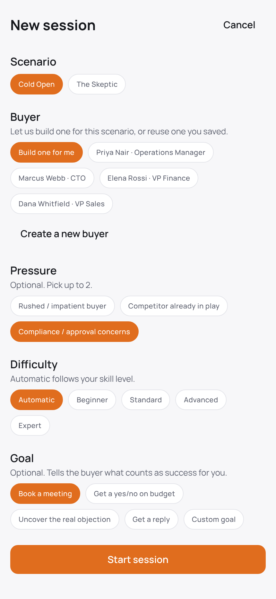
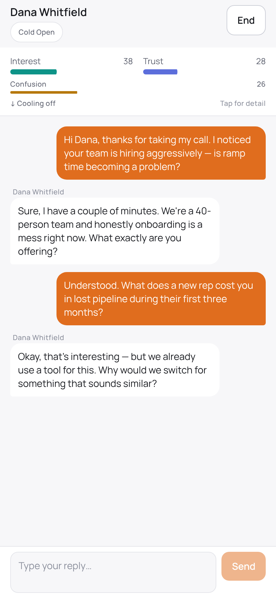
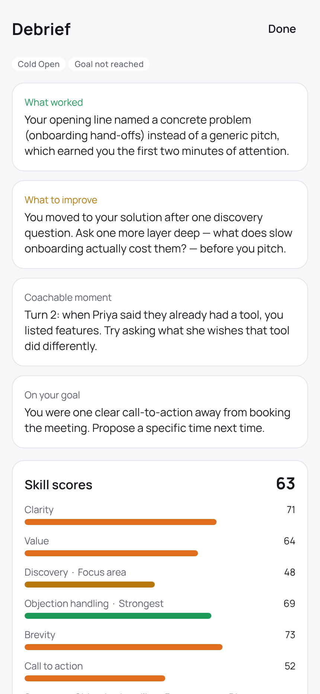
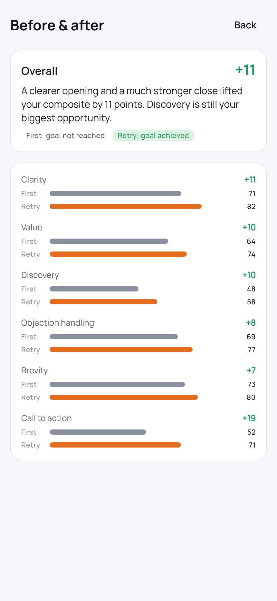

# DryRun Mobile

Expo / React Native / TypeScript client for DryRun, consuming the API in [`../backend`](../backend/README.md). It covers the whole practice loop: auth, the live session, debrief, replay and retry comparison, progress, playbooks, billing, team management, notifications and a signed-out demo.

See [`../docs/FRONTEND_ARCHITECTURE.md`](../docs/FRONTEND_ARCHITECTURE.md) for the design document the client was built from (API surface, data models, navigation, design system, milestones), and [`../docs/CONFIGURATION.md`](../docs/CONFIGURATION.md#2-mobile-client) for the environment variables.

## Screens

<div align="center">

<table>
<tr>
<td align="center" valign="top"><br><sub><b>New session</b><br>scenario, buyer, pressure, goal</sub></td>
<td align="center" valign="top"><br><sub><b>Live session</b><br>meters update every turn</sub></td>
<td align="center" valign="top"><br><sub><b>Debrief</b><br>coaching and six-axis score</sub></td>
<td align="center" valign="top"><br><sub><b>Retry comparison</b><br>per-axis deltas</sub></td>
</tr>
</table>

</div>

Every screen in phone (light and dark) and tablet is in [`../docs/screenshots/`](../docs/screenshots/).

## Setup

Start the backend first (see [`../backend/README.md`](../backend/README.md)), then:

```bash
cd frontend
npm install
cp .env.example .env   # set EXPO_PUBLIC_API_BASE_URL and the Supabase values
npm start
```

`EXPO_PUBLIC_API_BASE_URL` is the backend origin without `/api/v1`. On a physical device it must be an address the phone can reach, not `localhost`. The two `EXPO_PUBLIC_SUPABASE_*` values are optional: without them the app runs, minus persona-generation live status and Google sign-in. Every `EXPO_PUBLIC_*` value is inlined into the JS bundle, so never put a secret there.

## Stack

- Expo (managed) + React Native + TypeScript (strict)
- `expo-router` for file-based navigation
- TanStack Query for server state
- Zustand for client and UI state
- `react-hook-form` + `zod` for forms
- `axios` for HTTP
- `@supabase/supabase-js`, used only for the Realtime persona-status channel and the Google PKCE sign-in; everything else goes through the DryRun API

## Scripts

| Command | What it does |
|---|---|
| `npm start` | Expo dev server (`npm run ios`, `npm run android` and `npm run web` open a target directly) |
| `npm run typecheck` | `tsc --noEmit` |
| `npm run lint` | ESLint |
| `npm test` | Jest |

## Project layout

```
app/            expo-router routes — the navigation tree
  (public)/       signed-out: welcome, login, signup, email verification, password reset, demo
  (onboarding)/   Instant Setup (describe what you sell)
  (app)/          signed-in: tabs (home, practice, history, progress), session, persona,
                  playbooks, billing, workspace, notifications, settings
  invites/        accept a workspace invite
  playbook/       public shared-playbook view, by token
src/
  api/          one module per backend area, built on a shared axios client (httpClient.ts)
  hooks/        TanStack Query hooks and flow hooks (useLiveSession, useCheckoutFlow, ...)
  stores/       Zustand stores: auth, workspace, demo, pending route/invite, upgrade sheet
  components/   UI components, grouped by feature (billing, coaching, persona, simulation, ui)
  theme/        colors, fonts, spacing, typography, ThemeProvider
  config/       env.ts — reads and validates EXPO_PUBLIC_* values
  lib/          supabaseClient.ts
  utils/        pure helpers (validation, formatting, share links, idempotency keys, ...)
test/           Jest suites and MSW mocks
.maestro/       device smoke flows
```

### The HTTP client

`src/api/httpClient.ts` is the single place requests are configured. It injects the Bearer token and the `x-workspace-id` header, and intercepts three responses:

- **401** — one silent token refresh (concurrent 401s share it), then the original request is replayed.
- **402** — a feature-gate response, which opens the upgrade sheet instead of surfacing a raw error.
- **429** — rate limiting, surfaced as a typed error.

## Testing

`npm test` runs Jest with MSW mocks (`test/mocks/`). The suites cover the HTTP client (refresh and replay, the 402 upgrade gate), query-error mapping, stores, hooks and utilities. No backend is needed.

`.maestro/` holds four device smoke flows: login, a practice session through to the debrief, the signed-out demo funnel, and settings. They drive a real build against a seeded backend and are run manually, not in CI. See [`.maestro/README.md`](./.maestro/README.md).

CI (`.github/workflows/frontend-ci.yml`) runs typecheck, lint and Jest.
